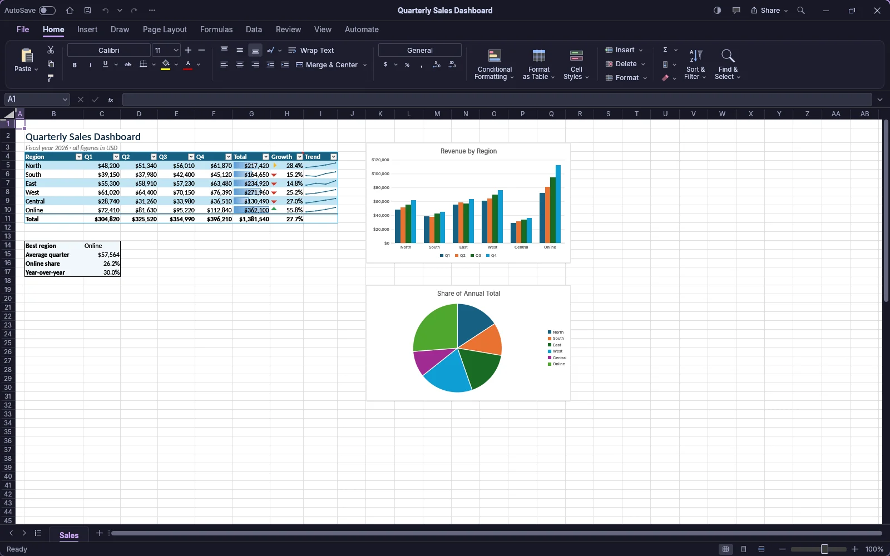

<p align="center"></p>

# VSheet

VSheet is the spreadsheet of [Vyntaris Office](https://vyntarisos.com/), the office suite of the
Vyntaris desktop. It opens and saves Excel workbooks (`.xlsx`, `.xlsm`), reads `.xls`, `.xlsb` and
OpenDocument `.ods`, and imports and exports CSV and TSV. Password-protected workbooks open with
their password and are saved with it again.

It is a fork of [GridCraft](https://github.com/storytold/gridcraft) by the ArtCraft Team. The
formula engine, the file formats and the interface are GridCraft's; this repository adds what
Vyntaris needs and keeps up with GridCraft's changes.



## Install

On Vyntaris it is optional: the `vsheet` package from the `[vyntaris]` repository.

```sh
sudo pacman -S vsheet        # or vyntaris-office for VDoc, VSheet and VSlide together
```

Updates come with the rest of the system (`sudo pacman -Syu`). VSheet never updates itself; Help ›
Check for Updates says so.

## What Vyntaris changes

- **The desktop's theme.** VSheet follows the GTK theme the Vyntaris shell writes: its light or
  dark flavour, its accent, its interface font, and the Catppuccin colours of the icons. A theme
  change restyles the open window. The sheet itself stays white paper, as it prints. View › Theme
  (System, Light, Dark) can still pick a fixed look; System follows the desktop.
- **Its own identity.** App id `org.vyntaris.VSheet`, its own icon and desktop entry
  (`packaging/linux/`), and an About window that points here and to GridCraft.
- **Wayland.** It runs as a native Wayland window at the desktop's scale.

Everything else works as in GridCraft.

## Files

| What | Where |
|---|---|
| Settings | `~/.config/vsheet/` |
| Log (attach it to a bug report) | `~/.config/vsheet/logs/vsheet.log` |

## Build

Rust 1.95 or newer:

```sh
cargo run --release -p vsheet             # the app
cargo run --release -p vsheet -- book.xlsx
cargo test -p vsheet-engine -p vsheet-ui-egui
```

The Vyntaris package builds `cargo build --release --locked -p vsheet` and installs the binary,
`packaging/linux/org.vyntaris.VSheet.{desktop,metainfo.xml}` and the icons from
`assets/app-icon/hicolor/*/apps/org.vyntaris.VSheet.*`.

## Branches

- `vyntaris` (default): VSheet.
- `upstream`: GridCraft's history with its name replaced by VSheet. New GridCraft releases are
  brought in by merging it into `vyntaris`.
- `main`: GridCraft as it is, kept for reference.

## Licence

MIT OR Apache-2.0, as GridCraft (`LICENSE-MIT`, `LICENSE-APACHE`). `NOTICE` names what comes from
GridCraft and what Vyntaris added. VSheet doesn't use the ArtCraft name or logos.

Bugs: [github.com/vyntaris/vsheet/issues](https://github.com/vyntaris/vsheet/issues).
